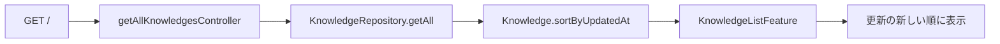

ナレッジ一覧 更新順ソート機能 (Issue #9) 実装 TODO
===============================================================================

目的
-------------------------------------------------------------------------------

Issue #9 の解決として、ナレッジ一覧を **更新日時の新しい順（降順）** に並び替えて表示できるようにする。

- 最新の作成・更新が一覧の先頭に表示される
- 既存のナレッジを更新すると、更新したナレッジが一覧の上位へ移動する
- 元の配列を破壊せず、副作用のないシンプルな実装にする
- 同じ秒に作成・更新されたナレッジでも並び順が安定する

既存実装の参考箇所
-------------------------------------------------------------------------------

- `src/models/knowledge.model.ts`
    - `Knowledge` は `createdAt`（作成日時）と `updatedAt`（更新日時）を UNIX タイムスタンプ（秒）で保持している
    - `Knowledge.create()` は作成時に `createdAt` と `updatedAt` を現在時刻で設定する
    - `Knowledge.update()` は更新時に `updatedAt` のみを現在時刻へ更新する
- `src/models/knowledge.model.test.ts`
    - `AGENTS.md` のルールに従い、`src/models/*.model.ts` には必ず単体テストを作成する
- `src/models/knowledge.repository.ts`
    - `getAll()` は `glob('./storage/**/*.json')` で全件を取得して返す（ファイルシステム順のため更新順にはなっていない）
- `src/controllers/get-all-knowledges.controller.tsx`
    - `KnowledgeRepository.getAll()` の結果を `KnowledgeListFeature` へ渡している
- `src/features/KnowledgeListFeature.tsx`
    - 一覧の各項目を表示している（現在は `knowledge.createdAt` を表示中）
- `src/router.test.ts`
    - `GET /` の一覧表示テストを配置している

ソート仕様の整理
-------------------------------------------------------------------------------

- **並び順**: `updatedAt` の降順（値が大きい＝より新しい更新が先頭）
- **同一 `updatedAt` の扱い（タイブレーク）**:
    - `updatedAt` は秒単位の UNIX タイムスタンプのため、同秒内に複数件が作成・更新されると値が一致しうる
    - `updatedAt` が同じ場合は `createdAt` の降順、さらに同じ場合は `knowledgeId` の昇順（`localeCompare`）などで決定的な順序にする
- **イミュータブル（非破壊）**:
    - `Array.prototype.sort()` は元の配列を直接書き換えるため、`toSorted()` または `[...knowledges].sort(...)` を使って新しい配列を返す

一覧表示時の基本フロー
-------------------------------------------------------------------------------



Step 1: モデルに更新順ソート関数を追加する
-------------------------------------------------------------------------------

- [x] `src/models/knowledge.model.ts` に更新日時順で並び替える関数（例: `sortByUpdatedAt`）を追加する
- [x] 引数は `readonly Knowledge[]`、戻り値は新しい `Knowledge[]` とする
- [x] 元の配列を変更しない（`toSorted()` または `[...knowledges].sort(...)` を使用する）
- [x] `updatedAt` の降順（`b.updatedAt - a.updatedAt`）で並び替える
- [x] `updatedAt` が同値の場合の比較基準（`createdAt` 降順 → `knowledgeId` 昇順）を決めて実装する
- [x] `export const Knowledge = { create, update, sortByUpdatedAt }` として公開する

実装イメージ:

```ts
/**
 * ナレッジを更新日時の新しい順（降順）に並び替える
 *
 * @param knowledges 並び替え対象のナレッジ配列
 * @returns 更新日時降順に並び替えた新しい配列
 */
function sortByUpdatedAt(knowledges: readonly Knowledge[]): Knowledge[] {
  return knowledges.toSorted((a, b) => {
    if (b.updatedAt !== a.updatedAt) return b.updatedAt - a.updatedAt;
    if (b.createdAt !== a.createdAt) return b.createdAt - a.createdAt;
    return a.knowledgeId.localeCompare(b.knowledgeId);
  });
}
```

この Step の完遂条件:

- `Knowledge.sortByUpdatedAt()` で任意の `Knowledge[]` を更新日時の新しい順へ並び替えられる
- 呼び出し元の配列が破壊されない

Step 2: モデルのソート処理の単体テストを作成する
-------------------------------------------------------------------------------

- [x] `src/models/knowledge.model.test.ts` に `sortByUpdatedAt` のテストグループを追加する
- [x] `updatedAt` が異なる複数件のナレッジが新しい順（降順）に並ぶテストを追加する
- [x] 既存ナレッジを `Knowledge.update()` で更新したとき、更新されたナレッジが先頭に来るテストを追加する
- [x] `updatedAt` が同じ場合でも安定した順序で並ぶテストを追加する
- [x] 元の配列が変更されない（非破壊である）ことを確認するテストを追加する
- [x] 空配列 (`[]`)・1 件のみの配列でも正常に動作するテストを追加する

この Step の完遂条件:

- `AGENTS.md` のルール通り、追加したモデルロジックに単体テストが揃っている
- `npm test` でモデルのソートテストがすべて成功する

Step 3: 一覧取得 Controller にソート処理を適用する
-------------------------------------------------------------------------------

- [x] `src/controllers/get-all-knowledges.controller.tsx` で `Knowledge.sortByUpdatedAt()` を呼び出す
- [x] `KnowledgeRepository.getAll()` で取得した配列をソートしてから `KnowledgeListFeature` へ渡す
- [x] `KnowledgeRepository` 自体はファイル I/O に専念させ、ソートのドメインルールはモデル側に保つ

実装イメージ:

```tsx
import { KnowledgeListFeature } from '../features/KnowledgeListFeature.js';
import { Knowledge } from '../models/knowledge.model.js';
import { KnowledgeRepository } from '../models/knowledge.repository.js';

export async function getAllKnowledgesController(userName: string) {
  const knowledges = Knowledge.sortByUpdatedAt(await KnowledgeRepository.getAll());

  return <KnowledgeListFeature knowledges={knowledges} userName={userName} />;
}
```

この Step の完遂条件:

- 一覧取得時に必ず更新日時の新しい順へ並び替えられた配列が Feature へ渡される

Step 4: 一覧画面の日時表示を更新順に合わせて確認・調整する
-------------------------------------------------------------------------------

- [x] `src/features/KnowledgeListFeature.tsx` の日時表示を確認する（現在は `knowledge.createdAt` を表示）
- [x] 更新順ソートと画面表示が一致するよう、一覧の日時を `knowledge.updatedAt` に変更する（または更新日時と分かる表記にする）
- [x] 375px の固定幅レイアウトと既存の Tailwind トークンを崩さないことを確認する

確認ポイント:

- 並び順が「更新順」なのに一覧上に「作成日時」しか見えないと、古い作成日時の記事が先頭にある理由がユーザーに伝わりにくいため、`updatedAt` を表示すると直感的になる

この Step の完遂条件:

- 一覧の並び順と各カードに表示される日時の整合性が取れている

Step 5: Router のテストを追加して一覧の表示順を検証する
-------------------------------------------------------------------------------

- [x] `src/router.test.ts` の `Knowledge list` に、未ソート順で返されたナレッジが更新日時の新しい順で HTML に出力されるテストを追加する
- [x] HTML 内のタイトル出現位置（`html.indexOf(...)` など）で、より新しく更新されたナレッジが先頭に表示されていることを検証する
- [x] 既存の `Knowledge list` テストが引き続き通ることを確認する

この Step の完遂条件:

- `GET /` のレスポンス HTML 上で更新日時降順に並んでいることを自動テストで保証できる

Step 6: 動作確認とビルドを実行する
-------------------------------------------------------------------------------

- [x] `npm test` を実行し、全テストが成功することを確認する
- [x] `npm run build` を実行し、Biome・TypeScript・Vite ビルドがすべて成功することを確認する
- [x] `npm start -- "テストユーザー"` を実行して一覧画面を開く
- [x] ナレッジを 2 件以上作成し、新しく作成したナレッジが一覧の先頭に表示されることを確認する
- [x] 古い方のナレッジを編集して更新し、一覧画面へ戻ったときに更新したナレッジが先頭へ移動していることを確認する
- [x] サーバー再起動後も一覧が更新順で表示されることを確認する

受け入れ条件
-------------------------------------------------------------------------------

- [x] 一覧画面のナレッジが `updatedAt` の新しい順（降順）で表示される
- [x] 既存ナレッジを更新すると、一覧の先頭に移動する
- [x] 元の配列を変更しない副作用のないソート実装になっている
- [x] 一覧に表示される日時と並び順に違和感がない
- [x] モデル単体テストおよび Router テストが追加されている
- [x] `npm test` と `npm run build` が成功する

推奨する実装順
-------------------------------------------------------------------------------

最初のスモールゴールは、`Knowledge.sortByUpdatedAt()` とその単体テストを完成させること（Step 1〜2）。
次に `getAllKnowledgesController` へ組み込み（Step 3）、一覧画面の日時表示と Router テストを整え（Step 4〜5）、最後にビルドと実画面で更新時の並び替えを確認する（Step 6）。

各 Step の完遂後に実行するコマンド:

```sh
npm test
npm run build
```
